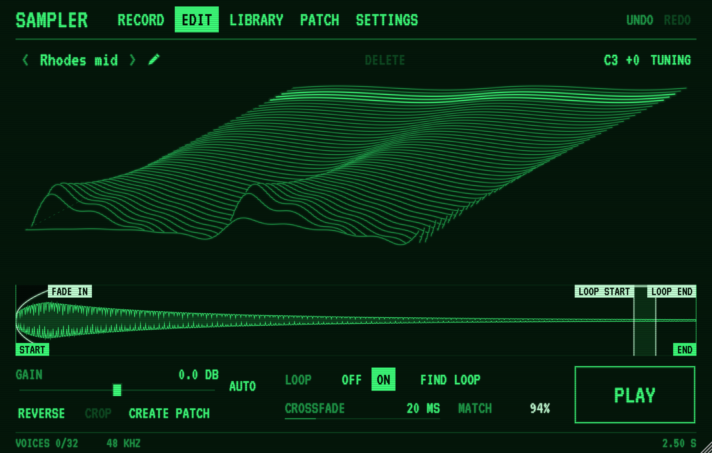

# Sampler

Sampler is a sampler instrument for making samples as well as playing them. It records from
the track's input, plays each recording from the keyboard at once, allows it to be trimmed,
looped and tuned, and gathers samples into patches laid across the keys. Its display is
modelled on the green phosphor monitor of the Fairlight CMI.

This repository is where Sampler releases are published. **[Download the latest
release](../../releases/latest).** The user guide is published beside the installers.

## What it does

- The Record page records from the input once it rises above a threshold, keeping the
  moment before it. A recording may be paused and resumed, and plays from any point that
  is clicked.
- The Edit page shows the sample as a stack of waveform segments in perspective. Start,
  end, loop and fades are set by dragging, and the loop may be found automatically. Gain,
  reverse, crop and a tuning panel complete the page.
- The Library page lists every sample by folder, with a search. Audio files are imported
  there or dropped onto the window.
- The Patch page lays samples across the keys and sets each patch's envelope, filter,
  character, voices, portamento, pitch-bend range and velocity response.
- A host's session recalls the patch and its samples exactly as they were when it was
  saved, and every sound setting may be automated.

## Requirements

- macOS 11 or later, on Apple silicon or Intel; or Windows 10 or 11, 64-bit.
- A host that loads Audio Units, VST3 or AAX plug-ins: Logic Pro, Ableton Live, Cubase,
  Reaper, Bitwig Studio, Studio One, Pro Tools and others. On the Mac, Sampler also runs as
  an application of its own.

## Installing

On the Mac, download the `.pkg` from the latest release and open it. It installs, for all
users:

- the Audio Unit in `/Library/Audio/Plug-Ins/Components`;
- the VST3 in `/Library/Audio/Plug-Ins/VST3`;
- the AAX in `/Library/Application Support/Avid/Audio/Plug-Ins`;
- the application in `/Applications`.

Any of them may be left out with **Customize** in the installer. The installer is signed
with a Developer ID and notarised by Apple.

On Windows, download the `Windows.exe` installer and run it. It installs the VST3 in
`C:\Program Files\Common Files\VST3` and the AAX in
`C:\Program Files\Common Files\Avid\Audio\Plug-Ins`, and is signed.

Samples and patches are kept in a folder named Sampler in the user's Music folder.

## Trial and licence

Without a licence, Sampler works in full but adds a short tone to its output every 30
seconds. To activate it, enter the email address to which the licence was issued and the
licence token in the box that opens with the window, or later on the Settings page.
Activation takes place offline and covers every instance of Sampler for that user account.

## Uninstalling

On the Mac, delete `Sampler.component`, `Sampler.vst3` and `Sampler.aaxplugin` from the
folders above, and `Sampler.app` from `/Applications`. On Windows, uninstall Sampler from
Settings, Apps. The library in the Music folder is left in place.

---

© Mark Hammond. All rights reserved.
